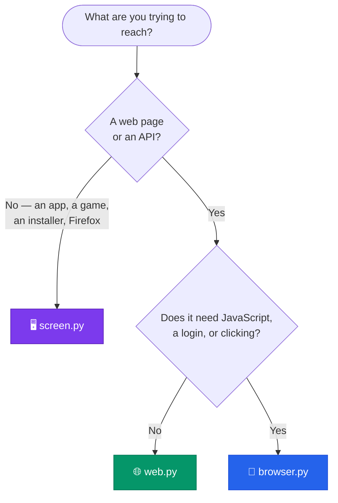

<div align="center">

# 🛠️ `.claude/tools`

### Browser, web & desktop control for Claude Code — and any other agent

*Give any AI session the ability to **see a screen**, **drive a real browser**, and **talk to the web**.*
*Any project. Any site. Any app.*

<br>


</div>

---

## ⚡ TL;DR

Four small scripts. Nothing tied to a particular repo. Drop them in, run the doctor, go.

```bash
python .claude/tools/doctor.py --install          # 1. install what's missing

python .claude/tools/web.py get https://site.com  # 2a. read the web (no deps, instant)
python .claude/tools/browser.py open https://site.com   # 2b. drive a real browser
python .claude/tools/screen.py shot               # 2c. look at the actual screen
```

> [!TIP]
> The killer feature: **`browser.py` keeps one browser open across commands.** Sign in
> by hand *once* — in any project, in any session, every later command is still signed in.

<br>

| | Tool | What it does | Needs |
|:--:|:--|:--|:--|
| 🌐 | **`web.py`** | HTTP: pages as readable text, JSON, links, downloads, POST | **nothing** (stdlib) |
| 🧭 | **`browser.py`** | A real browser that stays open — click, fill, screenshot, run JS. Logins persist | `playwright` |
| 🖥️ | **`screen.py`** | The whole desktop — screenshot, click, type, keys, windows. Drives *any* app | `pillow` · Windows |
| 🩺 | **`doctor.py`** | Checks & installs everything above | **nothing** (stdlib) |

---

## 📦 Install

<table>
<tr><td width="33%" valign="top">

**Already here?**

```bash
python doctor.py
python doctor.py --install
```

Check, then fix.

</td><td width="33%" valign="top">

**Into a project**

```powershell
.\install.ps1 -Target C:\code\app
```
```bash
./install.sh ~/code/app
```

</td><td width="33%" valign="top">

**Machine-wide**

```powershell
.\install.ps1 -Global
```
```bash
./install.sh --global
```
→ `~/.claude/tools`

</td></tr>
</table>

Add `-NoDeps`/`--no-deps` to skip dependency install, `-Force`/`--force` to overwrite.

**Requirements** — Python 3.8+. `web.py` runs anywhere with nothing installed. `browser.py`
works on Windows, macOS & Linux. `screen.py` is Windows-only.

---

## 🧭 Which tool?



> **Start with `web.py`** — it's instant and free. Reach for `browser.py` when the site needs
> JavaScript, a session, or clicking. Reach for `screen.py` when there's no DOM to talk to.

---

## 🌐 `web.py` — HTTP without a browser

```bash
python web.py get   https://example.com [--max 20000]   # HTML stripped to clean text
python web.py json  https://api.example.com/x --path data.items.0.name
python web.py links https://example.com --filter blog
python web.py dl    https://example.com/file.zip [out]
```

<details>
<summary><b>Full command reference</b></summary>

<br>

| Command | Does |
|:--|:--|
| `get URL` | Fetch and strip HTML down to readable text |
| `raw URL` | The body exactly as sent |
| `json URL` | Pretty-print JSON; `--path a.b.0` digs into it |
| `links URL` | Every link, absolute; `--filter sub` narrows |
| `head URL` | Status line + response headers |
| `dl URL [out]` | Download to a file |
| `post URL '{"a":1}'` | POST; `--json` (default) or `--form` |

**Flags on any command**

| Flag | Does |
|:--|:--|
| `-H "Name: value"` | Extra header (repeatable) |
| `--ua "..."` | Override User-Agent |
| `--timeout 30` | Seconds |
| `--cookies file.json` | Use a jar exported by `browser.py cookies` |
| `--insecure` | Skip TLS verification |
| `--max N` | Truncate output |

HTTP errors print with their body instead of raising, so you can read what the server
actually said.

</details>

---

## 🧭 `browser.py` — a real browser that stays open

The browser launches once and **keeps running between commands**.

```bash
python browser.py open  https://example.com
python browser.py fill  "#email" "me@example.com"
python browser.py click "text=Sign in"
python browser.py text  ".results"
python browser.py shot  out.png --full
```

<details>
<summary><b>Full command reference</b></summary>

<br>

| Command | Does |
|:--|:--|
| `start [--headless]` | Optional — any command auto-starts the browser |
| `open URL` | Navigate |
| `text [SEL]` | Visible text of the page or one element |
| `html [SEL]` | Markup |
| `shot [out] [--full]` | Screenshot, optionally full-page |
| `click "SEL"` | CSS, or `text=Sign in` |
| `fill "SEL" "value"` | Type into a field |
| `select "SEL" "value"` | Pick a dropdown option |
| `upload "SEL" path` | Attach a file |
| `press Enter` · `type "..."` | Raw keyboard |
| `wait "SEL" [--timeout ms]` | Block until it appears |
| `eval "js"` | Run JavaScript, get JSON back |
| `links [--filter sub]` | Every link on the page |
| `scroll N` | Screens, + down / − up |
| `back` · `forward` · `reload` | Navigation |
| `tabs` · `tab N` · `newtab [URL]` · `closetab` | Tab control |
| `cookies [--out f.json]` | Export the session |
| `pdf [out]` | Print to PDF (headless) |
| `status` · `stop` | Inspect / shut down |

</details>

### 🔐 Logins & profiles

Profiles live in `~/.claude/browser-profiles/NAME`, **shared by every project on the machine**.

```bash
python browser.py --profile work     open https://intranet.example.com
python browser.py --profile personal open https://example.com
```

> [!TIP]
> Run **without** `--headless` and the window is visible. Sign in by hand once and every
> later command — in this project or any other — is already signed in. Same answer for a
> captcha or an MFA prompt: clear that one step yourself, then hand control back.

### 🌍 Any Chromium browser

```bash
python browser.py start --channel chrome    # your installed Chrome
python browser.py start --channel msedge    # Edge
CLAUDE_BROWSER_EXE="C:\...\brave.exe" python browser.py start   # Brave / Vivaldi / Opera
```

With no `--channel`, Playwright's bundled Chromium is used.

> [!WARNING]
> **Firefox and Safari have no CDP** — drive them with `screen.py` instead.
>
> **A browser that's *already* open can't be attached to** unless it was started with a
> debug port. To automate the Chrome window in front of you right now, use `screen.py`.
> Use a second `--port 9333` to run a toolkit browser alongside your everyday one.

---

## 🖥️ `screen.py` — the whole desktop <sub><sup>Windows</sup></sub>

```bash
python screen.py shot              # look
python screen.py click 1120 289    # act on what you saw
python screen.py type "hello world"
```

<details>
<summary><b>Full command reference</b></summary>

<br>

| Command | Does |
|:--|:--|
| `shot [out] [--region X,Y,W,H] [--full]` | Screenshot; `--full` spans all monitors |
| `click X Y [right\|middle\|double]` | Click |
| `move X Y` · `drag X1 Y1 X2 Y2` | Move / drag |
| `type "text"` | Type character by character |
| `paste "long text"` | Via clipboard — instant and exact |
| `key ctrl+l` · `enter` · `alt+tab` | Key combos |
| `scroll -3` | + up / − down |
| `focus "window title"` | Raise a window |
| `windows` | List visible windows |
| `pos` | Cursor position, in both coordinate spaces |

</details>

> [!IMPORTANT]
> **Coordinates come from the screenshot you just looked at.** `shot` downscales to ≤1600px
> wide and records the scale *and* origin, so an X,Y read off the image maps back to the real
> pixel — including on 4K displays and `--region` crops. Take a shot, read coordinates off it,
> click them.

`paste` beats `type` for anything long: it goes through the clipboard, so it can't drop characters.

---

## 🍳 Recipes

<details open>
<summary><b>Scrape something behind a login</b></summary>

```bash
python browser.py start                       # visible window
python browser.py open https://site/login     # sign in by hand, once
python browser.py open https://site/reports
python browser.py text ".report-table"
```
</details>

<details>
<summary><b>Hand a browser session to the fast HTTP tool</b></summary>

```bash
python browser.py cookies --out c.json
python web.py get https://site/api/items --cookies c.json
```
</details>

<details>
<summary><b>Fill and submit a form</b></summary>

```bash
python browser.py open https://site/form
python browser.py fill "input[name=email]" "me@example.com"
python browser.py click "button[type=submit]"
python browser.py text body --max 500
```
</details>

<details>
<summary><b>Drive an app with no DOM (Firefox, a game, an installer)</b></summary>

```bash
python screen.py focus "Mozilla Firefox"
python screen.py shot                  # look at it
python screen.py key ctrl+l
python screen.py type "example.com"
python screen.py key enter
python screen.py shot                  # confirm
```
</details>

<details>
<summary><b>Pull a JSON API and dig into it</b></summary>

```bash
python web.py json https://api.github.com/repos/python/cpython --path stargazers_count
```
</details>

---

## 🤖 Tell Claude about it

Paste this into your project's `CLAUDE.md` so sessions reach for the toolkit on their own:

```markdown
## Browser / web / desktop tools
`.claude/tools/` holds scripts for web and screen work. Check with
`python .claude/tools/doctor.py` (add `--install` to fix anything missing).
- `python .claude/tools/web.py get URL` — fetch a page as text; also `json`,
  `links`, `dl`, `post`. No dependencies; try this first.
- `python .claude/tools/browser.py open URL` — real browser that stays open
  between commands, so logins persist; `text`, `click`, `fill`, `shot`, `eval`.
- `python .claude/tools/screen.py shot` — screenshot the desktop, then
  `click X Y` / `type` / `key` using coordinates read off that screenshot.
Run any of them with no arguments for full usage.
```

---

## 🩹 Troubleshooting

<details>
<summary><code>Missing playwright</code> / <code>Missing Pillow</code></summary>

<br>Run `python doctor.py --install`.
</details>

<details>
<summary><code>Browser did not open a CDP port</code></summary>

<br>Something already uses the port. Pass `--port 9333`, or run `python browser.py status`
to see what's running.
</details>

<details>
<summary><code>stop</code> says it can't stop the browser</summary>

<br>Close the window, or kill the process holding the port. `stop` closes the tabs → kills the
recorded pid → falls back to whoever is listening on the port.
</details>

<details>
<summary>Clicks land in the wrong place</summary>

<br>Take a fresh `screen.py shot` first. Coordinates are relative to the most recent
screenshot — if the window moved or you cropped a region since, the mapping is stale.
</details>

<details>
<summary>A page is empty or differs from what the browser shows</summary>

<br>It's JavaScript-rendered. Use `browser.py` rather than `web.py`.
</details>

<details>
<summary>Mangled characters in the console</summary>

<br>Shouldn't happen — all tools force UTF-8 output, so CJK, emoji and accented text print
correctly even in a `cp1252` Windows console.
</details>

---

## ⚠️ Notes

- **Bot challenges are a stop sign, not a bug.** Run the browser visibly, clear the captcha
  yourself, carry on — the session persists.
- **Profiles hold real cookies and logins.** `~/.claude/browser-profiles/` is as sensitive as
  your browser profile. Don't commit it or copy it around. *(`.gitignore` already blocks it,
  along with `cookies.json`.)*
- **`screen.py` controls the actual mouse and keyboard.** Whatever is focused receives the
  input — check with `shot` before typing.

<div align="center">
<br>

**MIT licensed** — see [`LICENSE`](LICENSE)

<sub>Built for <a href="https://claude.com/claude-code">Claude Code</a>, useful to any agent.</sub>

</div>
